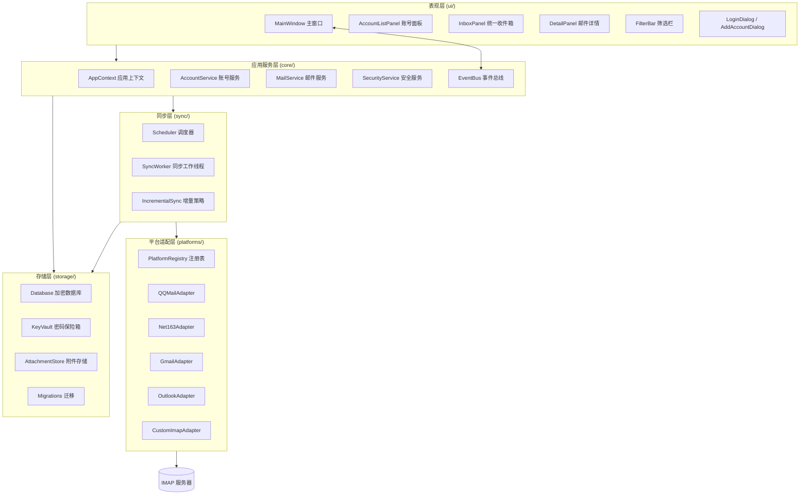
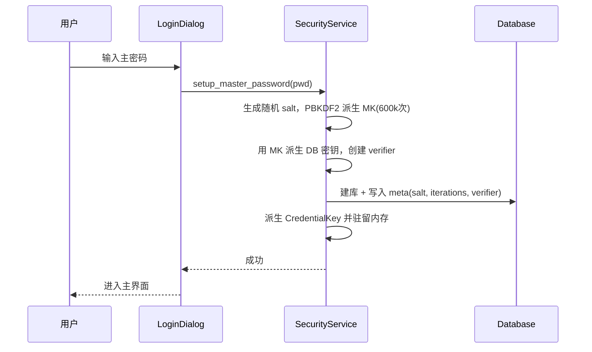
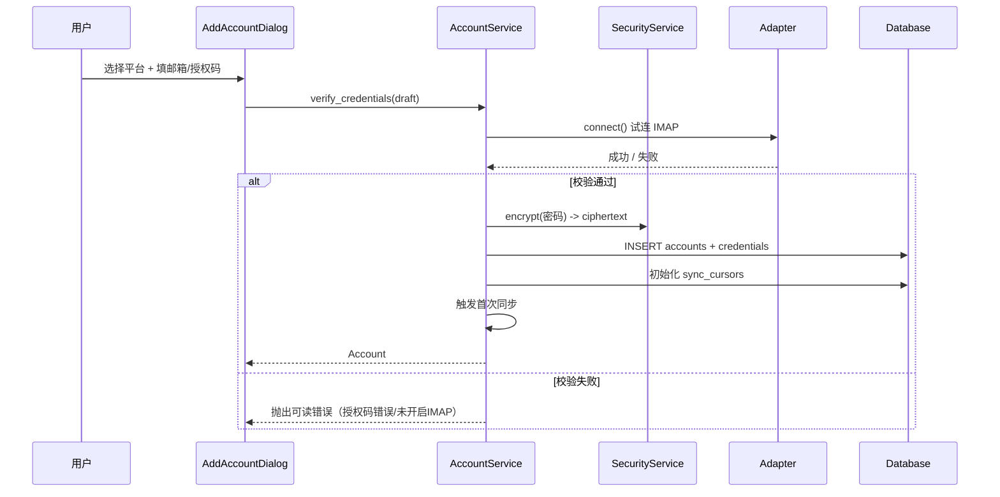
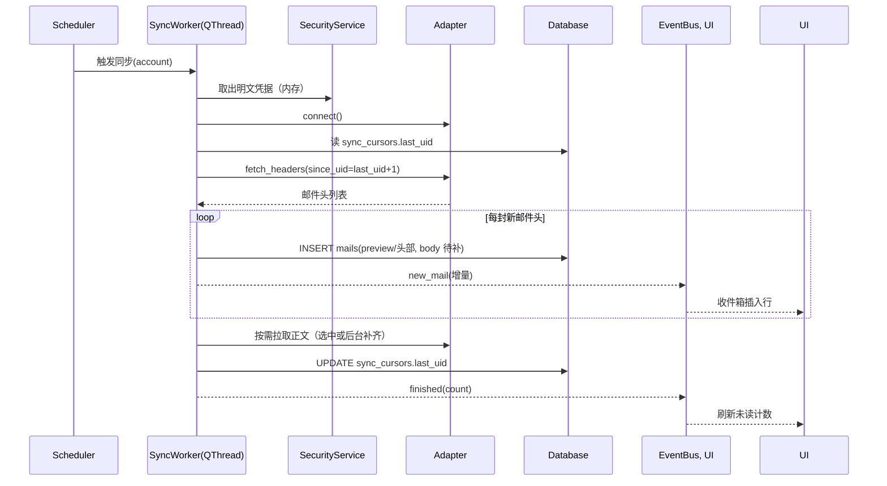
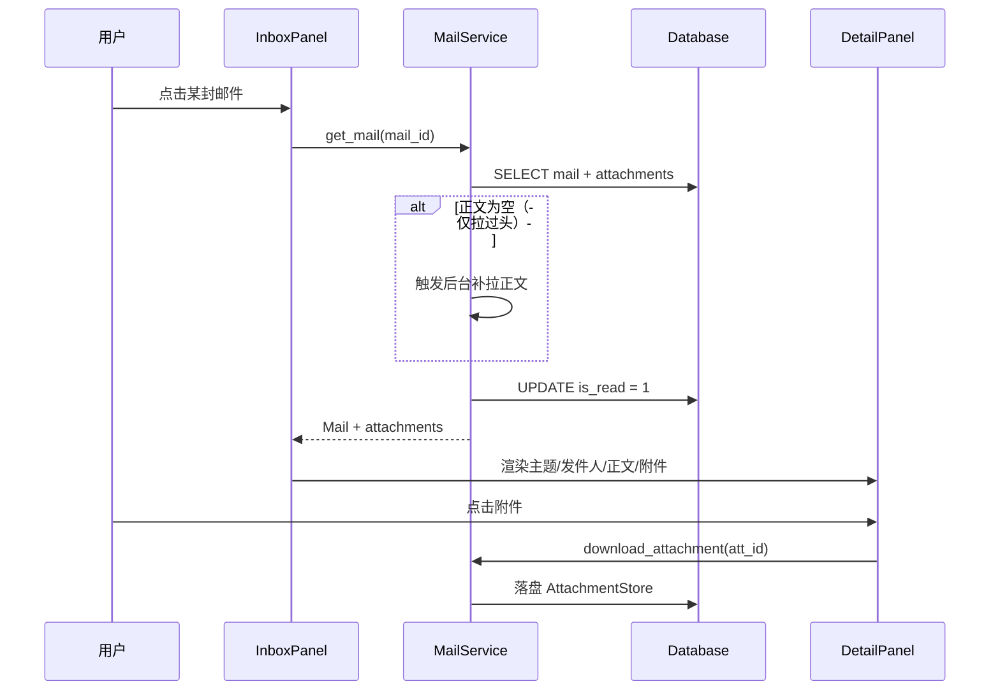

# UniMail 多平台邮箱统一管理程序 · 架构设计文档

> 版本：v1.0
> 更新日期：2026-10-15
> 形态：本地桌面应用（Python + PySide6），数据全部落盘本地并加密

---

## 1. 需求与目标

### 1.1 功能目标

| 编号 | 需求 | 设计目标 |
|---|---|---|
| R1 | 多账号添加 / 删除 / 切换 | 支持 QQ、163、Gmail、Outlook 及任意自定义 IMAP 服务器 |
| R2 | 统一收件箱视图 | 聚合所有账号最新邮件，展示发件人 / 主题 / 时间 / 预览 |
| R3 | 多维度筛选 | 按平台、关键词、时间范围筛选；已读/未读标记 |
| R4 | 邮件详情 | 正文（HTML/纯文本）+ 附件列表与下载 |
| R5 | 自动定时刷新 | 后台调度器按账号周期增量同步 |
| R6 | 本地加密存储 | 账号密码、邮件正文全量加密落盘 |

### 1.2 非功能目标

- **安全优先**：主密码不落盘；数据库整库加密；凭据与正文双重加密。
- **离线可用**：已同步邮件完全离线可读，不依赖公网。
- **增量同步**：基于 UID 记录已同步位置，避免重复拉取。
- **可扩展**：新增邮箱平台仅需实现一个适配器类。
- **响应性**：网络 IO 全部在后台线程/QThread 中执行，UI 永不阻塞。

### 1.3 技术选型

| 层 | 选型 | 理由 |
|---|---|---|
| UI | PySide6 (Qt 6) | 跨平台桌面、三栏布局原生支持、成熟稳定 |
| 协议 | `imaplib` + `email` (标准库) | 无第三方协议依赖，IMAP 通用 |
| 加密 | `cryptography` (Fernet / PBKDF2) | 工业级、API 简洁 |
| 数据库 | SQLCipher (via `sqlcipher3`) | 整库 AES-256 透明加密；原型提供 SQLite 降级 |
| 存储 | 本地文件（用户数据目录） | 离线、可控、易备份 |

---

## 2. 整体架构

### 2.1 分层架构图



### 2.2 分层职责

| 层 | 职责 | 禁止事项 |
|---|---|---|
| 表现层 | 渲染、交互、表单校验；只调用服务层接口 | 不直接访问数据库，不直接建 IMAP 连接 |
| 应用服务层 | 用例编排、领域校验、事务边界、事件发布 | 不包含 UI 代码，不包含协议细节 |
| 同步层 | 调度、并发、增量策略、失败重试 | 不感知 UI，不直接改数据库（经服务层） |
| 平台适配层 | 协议细节、服务器差异、编码差异 | 不写业务逻辑，不直接落库 |
| 存储层 | 加密、持久化、查询 | 不含业务规则 |

**核心原则：依赖单向向下。** 平台适配层通过统一接口向上暴露，替换平台不影响上层。

---

## 3. 核心模块划分

### 3.1 账号管理模块 `AccountService`

**职责**：账号的增删改查、切换当前活跃账号、连通性校验。

**关键接口**

```python
class AccountService:
    def add_account(self, draft: AccountDraft) -> Account
    def delete_account(self, account_id: str) -> None
    def update_account(self, account_id: str, patch: dict) -> Account
    def list_accounts(self) -> list[Account]
    def verify_credentials(self, draft: AccountDraft) -> VerifyResult   # 试连 IMAP
    def set_active(self, account_id: str | None) -> None
```

**要点**

- `AccountDraft` 承载明文密码，仅在内存中存在，进入 `SecurityService` 后立即加密，**绝不写入日志**。
- `verify_credentials` 添加账号前先试连，避免存入无效凭据。
- 删除账号时级联清理：凭据、该账号邮件、附件（事务内）。
- 切换账号只改变收件箱过滤条件，不重新建连。

### 3.2 加密存储模块 `SecurityService` + `Database` + `KeyVault`

**三层加密模型**

```
主密码 (用户输入，不落盘)
   │  PBKDF2-HMAC-SHA256, 600,000 次迭代, 随机 16B salt
   ▼
主密钥 MK (32B)  ──► SQLCipher 数据库密钥（整库 AES-256）
   │  HKDF 派生
   ▼
凭据密钥 CK ──► Fernet 加密账号密码 (KeyVault)
```

**要点**

- 主密码仅参与派生，**内存中不留存**；salt 与校验块存 `meta` 表。
- 登录校验：用 MK 解出 `verifier` 密文比对，失败即拒绝（配合指数退避防爆破）。
- 密码字段在数据库中以密文存储，即使拿到 db 文件也无法还原明文。
- 自动锁定：空闲超时可清除内存密钥并要求重新输入主密码。

### 3.3 邮件同步模块 `Scheduler` + `SyncWorker` + `Adapter`

**同步策略**

| 策略 | 说明 |
|---|---|
| 首次同步 | 按配置拉取最近 N 封（默认 100），记录每个文件夹最大 UID |
| 增量同步 | `UID SEARCH UID <last_uid+1>:*` 只拉新邮件 |
| 定时刷新 | 调度器按账号 `sync_interval` 触发，默认 5 分钟 |
| 并发控制 | 每账号一个 QThread；账号之间并行，同账号内串行 |
| 失败重试 | 指数退避（30s→2m→10m），连续失败标记账号为"异常" |

**并发模型**

```
主线程 (UI/事件循环)
   └─ Scheduler (QTimer 心跳, 主线程)
        ├─ SyncWorker(QQ账号)   [QThread]  → IMAP → 解析 → 入库 → 发信号
        ├─ SyncWorker(163账号)  [QThread]
        └─ SyncWorker(Gmail账号)[QThread]
                        │
                 signals: progress / new_mail / error / finished
                        ▼
                   EventBus → UI 增量刷新
```

### 3.4 平台适配模块 `PlatformRegistry` + `Adapter`

**统一适配接口**

```python
class ImapAdapter(ABC):
    platform: str
    config: PlatformConfig          # 服务器地址、端口、加密方式、授权码说明

    @abstractmethod
    def connect(self, account: Account, secret: Secret) -> ImapSession: ...
    @abstractmethod
    def list_folders(self, session) -> list[Folder]: ...
    @abstractmethod
    def fetch_headers(self, session, folder, since_uid) -> list[RawHeader]: ...
    @abstractmethod
    def fetch_body(self, session, folder, uid) -> MailBody: ...
    @abstractmethod
    def normalize(self, raw) -> NormalizedMail: ...   # 平台差异归一化
```

**多平台差异对照表**

| 平台 | IMAP 服务器 | 端口 | 认证方式 | 关键差异 / 坑点 |
|---|---|---|---|---|
| QQ 邮箱 | `imap.qq.com` | 993 SSL | 授权码（非登录密码） | 需在设置中开启 IMAP 并生成授权码；`INBOX` 编码 GBK 需转码 |
| 163 邮箱 | `imap.163.com` | 993 SSL | 授权码 | 需开启 IMAP/SMTP；首次连接需发送 `ID` 命令，否则报 `Unsafe Login` |
| Gmail | `imap.gmail.com` | 993 SSL | 应用专用密码 | 需开启两步验证后生成 App Password；推荐使用 `X-GM-EXT-1` 扩展获取标签 |
| Outlook | `outlook.office365.com` | 993 SSL | OAuth2（或应用密码） | 微软已停用基础认证，**推荐 OAuth2**；IMAP 需租户开启 |
| 自定义 | 用户填写 | 用户填写 | 密码 / 授权码 | 提供 SSL/TLS/STARTTLS 选项 |

> 设计上把「平台差异」全部收敛到适配器内部（服务器参数、特殊命令、编码处理），上层只面对 `NormalizedMail`。

### 3.5 邮件展示模块 `ui/`

**三栏布局**

```
┌──────────────┬───────────────────────────────┬──────────────────────┐
│ 账号面板      │  筛选栏：平台▾ 关键词🔍 时间▾  │  邮件详情             │
│ ┌──────────┐ ├───────────────────────────────┤  主题                 │
│ │ 全部邮箱  │ │ ● 张三      项目进度同步  14:20│  发件人 / 收件人 / 时间 │
│ │ QQ邮箱  3 │ │ ○ 李四      Re: 设计稿    13:05│  ───────────────────  │
│ │ 163邮箱 1 │ │ ● 系统通知   账单已出    12:30│  正文（HTML 渲染）     │
│ │ Gmail   0 │ │ ...                            │  ───────────────────  │
│ │ Outlook 5 │ │                                │  附件：📎 report.pdf  │
│ └──────────┘ │                                │        📎 logo.png    │
│ [+ 添加账号]  │                                │                      │
└──────────────┴───────────────────────────────┴──────────────────────┘
```

**要点**

- 收件箱用 `QTableView + QAbstractTableModel`（虚拟化，万级邮件不卡）。
- 未读邮件加粗+圆点标记；点击即标记已读并异步上报（不阻塞）。
- 正文 HTML 通过清洗后渲染（移除远程图片/脚本，防跟踪像素）。
- 附件按需下载，落盘到 `AttachmentStore`。

---

## 4. 关键数据结构

### 4.1 领域模型（内存对象）

```python
@dataclass
class Account:
    id: str                 # uuid4
    platform: str           # qq / 163 / gmail / outlook / custom
    email: str
    display_name: str
    imap_host: str
    imap_port: int
    use_ssl: bool
    username: str           # 通常 = email
    credential_ref: str     # 指向 KeyVault 中的密文条目
    sync_interval: int      # 秒
    last_synced_at: datetime | None
    status: AccountStatus   # ok / error / syncing / disabled

@dataclass
class Mail:
    id: str                 # uuid4
    account_id: str
    platform: str
    folder: str
    uid: str                # IMAP UID（账号内唯一）
    message_id: str         # RFC822 Message-ID
    subject: str
    from_name: str
    from_addr: str
    to_addrs: list[str]
    date: datetime
    preview: str            # 纯文本摘要（前 200 字）
    body_text: str          # 纯文本正文
    body_html: str          # HTML 正文（已清洗）
    has_attachments: bool
    is_read: bool
    is_starred: bool
    raw_size: int

@dataclass
class Attachment:
    id: str
    mail_id: str
    filename: str
    content_type: str
    size: int
    stored_path: str | None   # 下载后落盘路径
    content_id: str | None    # 内嵌资源
```

### 4.2 数据库 Schema（SQLCipher 加密库）

```sql
-- 元信息 / 安全
CREATE TABLE meta (
    key         TEXT PRIMARY KEY,
    value       TEXT NOT NULL
);
-- 存: db_version / kdf_salt / kdf_iterations / master_verifier

-- 账号
CREATE TABLE accounts (
    id              TEXT PRIMARY KEY,
    platform        TEXT NOT NULL,
    email           TEXT NOT NULL,
    display_name    TEXT DEFAULT '',
    imap_host       TEXT NOT NULL,
    imap_port       INTEGER NOT NULL,
    use_ssl         INTEGER NOT NULL DEFAULT 1,
    username        TEXT NOT NULL,
    sync_interval   INTEGER NOT NULL DEFAULT 300,
    last_synced_at  TEXT,
    status          TEXT NOT NULL DEFAULT 'ok',
    created_at      TEXT NOT NULL,
    UNIQUE(platform, email)
);

-- 凭据保险箱（密文）
CREATE TABLE credentials (
    id              TEXT PRIMARY KEY,        -- = account.id
    ciphertext      BLOB NOT NULL,           -- Fernet 加密后的密码
    created_at      TEXT NOT NULL,
    updated_at      TEXT NOT NULL,
    FOREIGN KEY(id) REFERENCES accounts(id) ON DELETE CASCADE
);

-- 同步游标（增量同步）
CREATE TABLE sync_cursors (
    account_id      TEXT NOT NULL,
    folder          TEXT NOT NULL,
    last_uid        INTEGER NOT NULL DEFAULT 0,
    uid_validity    INTEGER,
    updated_at      TEXT,
    PRIMARY KEY(account_id, folder),
    FOREIGN KEY(account_id) REFERENCES accounts(id) ON DELETE CASCADE
);

-- 邮件
CREATE TABLE mails (
    id              TEXT PRIMARY KEY,
    account_id      TEXT NOT NULL,
    platform        TEXT NOT NULL,
    folder          TEXT NOT NULL DEFAULT 'INBOX',
    uid             TEXT NOT NULL,
    message_id      TEXT,
    subject         TEXT,
    from_name       TEXT,
    from_addr       TEXT,
    to_addrs        TEXT,          -- JSON 数组
    date            TEXT NOT NULL, -- ISO8601 UTC
    preview         TEXT,
    body_text       TEXT,
    body_html       TEXT,
    has_attachments INTEGER NOT NULL DEFAULT 0,
    is_read         INTEGER NOT NULL DEFAULT 0,
    is_starred      INTEGER NOT NULL DEFAULT 0,
    raw_size        INTEGER DEFAULT 0,
    created_at      TEXT NOT NULL,
    UNIQUE(account_id, folder, uid)
);

-- 附件
CREATE TABLE attachments (
    id              TEXT PRIMARY KEY,
    mail_id         TEXT NOT NULL,
    filename        TEXT,
    content_type    TEXT,
    size            INTEGER,
    stored_path     TEXT,
    content_id      TEXT,
    FOREIGN KEY(mail_id) REFERENCES mails(id) ON DELETE CASCADE
);

-- 索引（筛选性能）
CREATE INDEX idx_mails_date     ON mails(date DESC);
CREATE INDEX idx_mails_account  ON mails(account_id, date DESC);
CREATE INDEX idx_mails_platform ON mails(platform, date DESC);
CREATE INDEX idx_mails_read     ON mails(is_read);
CREATE INDEX idx_mails_folder   ON mails(account_id, folder, uid);
```

> 关键词搜索：SQLite `LIKE` 满足原型需求；生产可替换为 FTS5 全文索引（`CREATE VIRTUAL TABLE mails_fts USING fts5(subject, body_text, content='mails')`）。

### 4.3 统一邮件模型 `NormalizedMail`

平台适配器把各自原始报文统一转换成：

```python
@dataclass
class NormalizedMail:
    uid: str
    message_id: str
    subject: str
    from_name: str
    from_addr: str
    to_addrs: list[str]
    date: datetime
    body_text: str
    body_html: str
    preview: str
    attachments: list[AttachmentMeta]
    raw_size: int
```

---

## 5. 主要业务流程

### 5.1 首次启动 / 设置主密码



### 5.2 添加邮箱账号



### 5.3 邮件同步流程（增量）



### 5.4 统一收件箱查询与筛选

```mermaid
flowchart LR
    A[用户操作筛选栏] --> B{构建查询条件}
    B --> C[platform IN (...)]
    B --> D[keyword LIKE %..%]
    B --> E[date BETWEEN a AND b]
    B --> F[is_read = 0/1]
    C & D & E & F --> G[拼装参数化 SQL]
    G --> H[(加密库查询)]
    H --> I[QAbstractTableModel 刷新]
    I --> J[三栏 UI 渲染]
```

> 所有条件走**参数化 SQL**，杜绝注入；结果按 `date DESC` 分页（默认每页 200 条，滚动加载）。

### 5.5 查看邮件详情



### 5.6 自动定时刷新

```python
class Scheduler(QObject):
    """主线程心跳调度，每 tick 检查各账号是否到期。"""
    def __init__(self, account_service, worker_pool, tick_seconds=30):
        self._timer = QTimer()
        self._timer.timeout.connect(self._tick)
        self._timer.start(tick_seconds * 1000)

    def _tick(self):
        now = utcnow()
        for acc in self._account_service.list_accounts():
            if acc.status == "disabled":
                continue
            due = acc.last_synced_at is None or \
                  (now - acc.last_synced_at).total_seconds() >= acc.sync_interval
            if due and not self._worker_pool.is_running(acc.id):
                self._worker_pool.dispatch(acc.id)
```

---

## 6. 安全设计

| 威胁 | 对策 |
|---|---|
| 数据库文件被拷走 | SQLCipher 整库 AES-256 加密，无主密码不可读 |
| 密码明文泄露 | 密码字段二次 Fernet 加密；密钥由主密码派生，不落盘 |
| 内存抓取 | 主密码用后即弃；闲置自动锁定并清除驻留密钥 |
| 暴力破解 | PBKDF2 60 万次迭代 + 随机 salt + 登录失败指数退避 |
| 邮件跟踪像素 | HTML 渲染前剥离远程图片与脚本 |
| 附件风险 | 附件不自动执行；文件名净化；可选杀毒扫描 |
| 日志泄露 | 日志脱敏，绝不打印密码 / 授权码 / 正文 |

---

## 7. 目录结构

```text
unimail/
├── main.py                      # 入口：初始化安全服务 → 登录 → 主窗口
├── requirements.txt
├── docs/
│   └── 架构设计.md               # 本文档
└── unimail/
    ├── config.py                # 常量、路径、默认服务器配置
    ├── core/
    │   ├── models.py            # 领域模型 dataclass
    │   ├── security.py          # SecurityService：KDF / 加密 / 保险箱
    │   ├── account_service.py   # 账号管理用例
    │   ├── mail_service.py      # 邮件查询 / 详情 / 附件用例
    │   └── events.py            # EventBus 事件总线
    ├── storage/
    │   ├── database.py          # 加密数据库连接与迁移
    │   └── repositories.py      # account/mail 仓储
    ├── sync/
    │   ├── scheduler.py         # 定时调度
    │   └── worker.py            # QThread 同步工作单元
    ├── platforms/
    │   ├── base.py              # ImapAdapter 抽象基类 + PlatformConfig
    │   ├── registry.py          # 平台注册表
    │   ├── qq.py / net163.py / gmail.py / outlook.py / custom.py
    │   └── parser.py            # MIME 解析 / 编码归一化
    └── ui/
        ├── main_window.py       # 三栏主窗口
        ├── account_panel.py
        ├── inbox_panel.py
        ├── detail_panel.py
        ├── filter_bar.py
        └── dialogs.py           # 登录 / 添加账号
```

---

## 8. 扩展性设计

| 扩展点 | 做法 |
|---|---|
| 新增邮箱平台 | 在 `platforms/` 加一个 Adapter 子类 + 注册到 `PlatformRegistry`，零改动上层 |
| 新增筛选维度 | `MailRepository.query()` 增加一个条件分支 + 筛选栏加控件 |
| 换用 FTS5 全文搜索 | 建虚拟表 + 替换 `keyword` 查询实现，接口不变 |
| 增加 OAuth2 | 新增 `AuthProvider` 抽象，凭据保险箱存 refresh_token |
| 增加 POP3 / Exchange | 新增协议层实现，复用统一下游管道 |
| 云同步 | 存储层抽象出 `Repository` 接口，替换为远端实现 |

---

## 9. 已知限制与生产化建议

| 项 | 原型现状 | 生产建议 |
|---|---|---|
| 数据库加密 | 优先 SQLCipher，缺失时降级 SQLite + 字段级加密 | 强制 SQLCipher 或系统钥匙串 |
| Gmail / Outlook 认证 | 支持应用专用密码 | 接入 OAuth2，避免密码存储 |
| 附件预览 | 列表 + 下载 | 内嵌 PDF / 图片预览、沙箱打开 |
| 全文搜索 | LIKE | FTS5 + 中文分词 |
| 多端同步 | 单机 | 端到端加密的同步服务 |
| 发信功能 | 仅接收（本期范围） | SMTP 发送 + 草稿箱 |
```